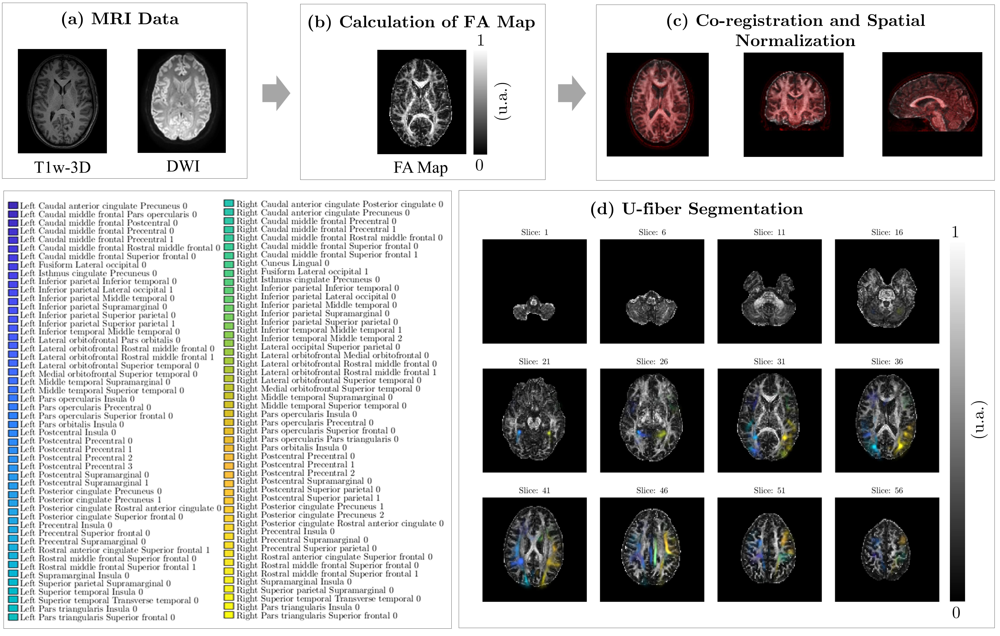

# An Interpretable Diffusion MRI-Based Machine Learning Framework for Exploratory Analysis of U-Fiber Microstructure and Cognitive Phenotypes in Multiple Sclerosis

This repository contains the **explainable machine learning pipeline** developed to identify and characterize **cognitive impairment in Relapsing–Remitting Multiple Sclerosis (RRMS)** using diffusion MRI–derived **fractional anisotropy (FA) biomarkers from subcortical U-fiber white matter**.

The framework integrates diffusion MRI preprocessing, atlas-based feature extraction, feature selection, supervised classification, and model interpretability to discriminate between:

- Healthy controls with preserved cognition (HC-CP)
- RRMS patients with preserved cognition (RRMS-CP)
- RRMS patients with cognitive impairment (RRMS-CI)

Cognitive status is defined using the **Brief Memory and Attention Test (BMAT)**, while microstructural white-matter integrity is quantified through FA values extracted from U-fiber regions defined by the **LNAO-SWM79 atlas**.
---

## Objective

The primary objective of this project is to develop a **reproducible and interpretable machine learning framework** capable of identifying MRI-based biomarkers of cognitive impairment in RRMS. By focusing on **short-range subcortical U-fiber pathways**, this work aims to capture microstructural alterations that are not readily detected by conventional lesion-based MRI analyses.

---

## Methods Overview

- **Diffusion MRI processing** to compute fractional anisotropy (FA) maps  
- **Atlas-based feature extraction** from subcortical U-fiber regions (LNAO-SWM79)  
- **Random Forest classification** for multi-class discrimination (HC-CP, RRMS-CP, RRMS-CI)  
- **Sequential Forward Selection (SFS)** to identify the most informative FA features  
- **Stratified cross-validation** for robust performance evaluation  
- **Explainable AI using SHAP** for global and subject-level interpretation of model predictions  

---

## Key Results

- Optimal classification accuracy of approximately **81%** using a compact subset of **44 U-fiber FA features**
- Discriminative features primarily involve **frontal, parietal, temporal, insular, and cingulate U-fiber pathways**
- Explainable ML analyses reveal **distributed and non-linear microstructural alterations** associated with cognitive impairment in RRMS

---

## Relevance

This repository supports research into **MRI-based biomarkers of cognitive dysfunction in multiple sclerosis**, providing a transparent and reproducible framework that complements neuropsychological assessment. The use of explainable machine learning facilitates biological interpretability and supports potential clinical translation.


---

## Pipeline Overview



---

## Repository Contents

- `codes` — Main machine learning pipeline and stability selection
- `dataset` — Processed dataset with FA features and BMAT scores
- `results-images` — Result images
- `requirements.txt` — Python dependencies
- `Figure1.png` — Preprocessing pipeline visualization

---

## Methods Summary

**Modalities**: T1-weighted, Diffusion Tensor Imaging (DTI)  
**Subjects**: 99 subjects (41 Healthy Controls, 58 RRMS patients)  
**MRI Scanner**: Philips Ingenia 3T  
**Assessment**: Brief Memory and Attention Test (BMAT) to ssess verbal memory

Fractional Anisotropy features were extracted from 100 U-fiber regions using:
- DSI Studio for FA map computation
- SPM12 for co-registration and normalization
- LNAO-SWM79 Atlas for U-fiber region definition

### Feature Processing:
- Ridge regression for initial feature importance ranking
- Sequential Feature Selection (SFS) with Random Forest
- Optimal feature subset selection
- Hierarchical clustering for feature correlation analysis

### Models Evaluated:
- **Tree-based**: Random Forest

### Model Selection & Validation:
- **GridSearchCV** with 5-fold stratified cross-validation
- **5-fold stratified cross-validation repeated 10 times** for robust performance estimation
- Hyperparameter optimization for each model
- Performance metrics: 

### Interpretability:
- **SHAP analysis** for global and local feature importance
- Decision surfaces plots
- **t-SNE** for selected FA features

---

## Reproducibility

- Python 3.11 (ML-pipeline)
- All random seeds fixed using `random`, `numpy`, `check_random_state`
- Classifiers use `random_state=42`
- StratifiedKFold CV is reproducible
- All model outputs and metrics exported to CSV

> MRI scans are not publicly available. Contact **Ethel Ciampi (ethelciampi@gmail.com)** for access or clinical inquiries.

---

## How to Run

1. Clone the repository:
```bash
git clone https://github.com/pamelaFranco/explainable-cognitive-impairment-relapsing-remitting-ms
cd explainable-cognitive-impairment-relapsing-remitting-ms
```

2. Install dependencies:
```bash
pip install -r requirements.txt
```

3. Run the pipeline:
```bash
python MS_strategy.py
```

---

## License

MIT License

---

## Acknowledgements

This work is supported by the National Agency for Research and Development (ANID), project ICN2021_004 of the Millennium Science Initiative Program. Additional support provided by ANID through the project Fondecyt de Iniciación en Investigación 2025 Nº 11250867, and by the Competition for Research Regular Projects, year 2023, code LPR23-17, Universidad Tecnológica Metropolitana.